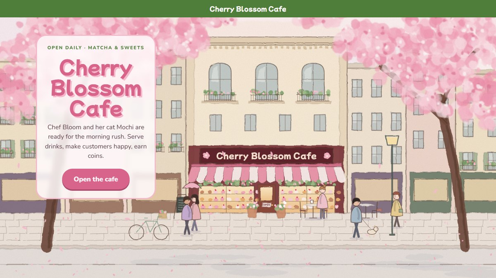
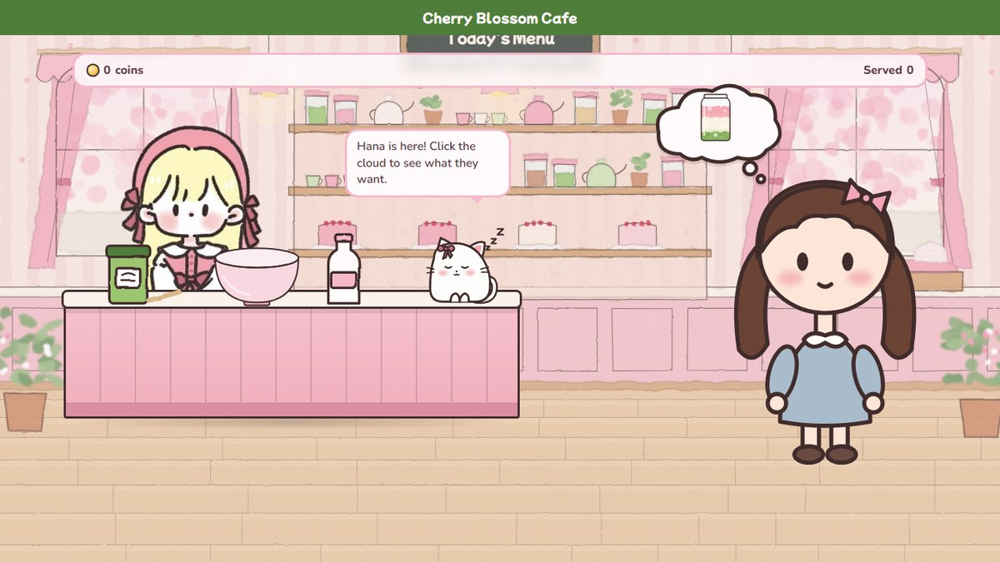
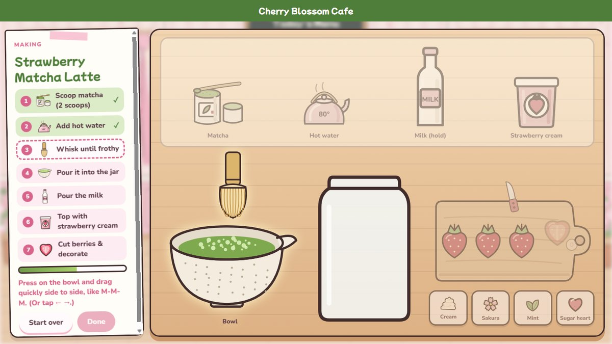
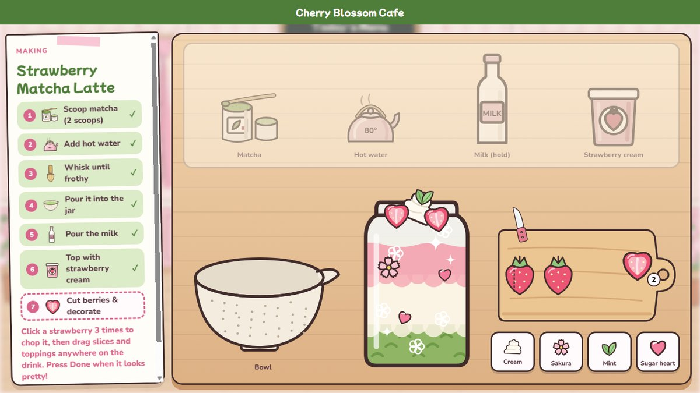
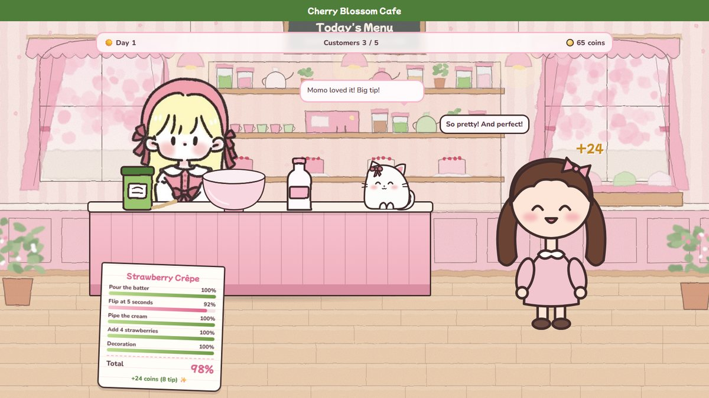

# 🌸 Cherry Blossom Cafe 🍵

**A cosy pink-and-green cafe cooking game, made in the browser.**

Chef Bloom and her sleepy cat Mochi run a little cafe under the cherry trees.
Customers drop by with a drink in mind. You whisk, pour, chop and decorate,
then send them off happy (and earn a few coins on the way).

*Built step by step while learning HTML, CSS and JavaScript. No frameworks, no installs.*

---

## 🍓 Meet the crew

**Chef Bloom** stands behind the counter. She sways, blinks, nods when you're doing well, and hops (with a little heart) when a drink is perfect. Click her and Mochi will tell you a secret about her.

**Mochi** naps on the counter with floating *Zzz*s. He wakes up to give you tips, stretches when you nail an order, and grumbles if you poke him awake: *"I'm not sleeping, I'm supervising."*

---

## ☕ How to play

| | |
|---|---|
|  | **1. A customer walks in.** Their thought cloud shows the drink they're dreaming of. Click the cloud. |
|  | **2. Read the recipe card.** It shows the drink, every step in order, and the price. Click **Continue**. |
|  | **3. Make it at the work station.** Scoop the matcha, add hot water, then *really whisk*: drag side to side until the foam meter fills. Pour it into the jar, then **hold** the milk bottle and let go between the pink lines. |
|  | **4. Decorate however you like.** Chop strawberries on the board (3 chops = 4 slices), then drag slices, cream, sakura flowers, mint and sugar hearts *anywhere* on the drink. |
|  | **5. Serve it!** Your customer reacts, pays (with a tip for a perfect pour and a bonus for every topping), and the next one wanders in. |

---

## 🧁 The menu

| Drink | How it's made | Price |
|---|---|---|
| 🍵 **Strawberry Matcha Latte** | Hands-on matcha station: scoop, whisk, pour, layer, decorate | 15 coins |
| 🍓 **Strawberry Milk** | Strawberry, ice, milk | 10 coins |
| 🌸 **Sakura Tea** | Sakura, hot water, honey | 9 coins |
| 🍯 **Honey Coffee** | Coffee, honey, milk | 11 coins |

Every drink can be decorated. Customers love toppings! 💕

---

## 🎀 Play it

1. Download or clone this repo.
2. Open **`index.html`** in your browser.
3. Click the pink **Open the cafe** sign hanging from the wooden board, and walk inside.

That's it: no installs, no build step. Works with a mouse, a touchscreen, or a keyboard (← → to whisk, Space to pour).

---

## 🗂️ What's inside

| File | What it does |
|---|---|
| `index.html` | The structure: every screen, button and character |
| `style.css` | The look: colours, layout, and all the little animations |
| `game.js` | The customer loop: arrive → recipe → make → serve → pay → leave |
| `menu.js` | The drinks, the ingredients, and how to draw a glass |
| `customers.js` | Draws random customers in Bloom's style, with 3 moods |
| `matcha.js` | The Matcha Station mini-game (scoop, whisk, pour, layer) |
| `sparkles.js` | The little sparkle trail behind the flower mouse |
| `decor.js` | The cutting board and drag-anywhere toppings |
| `paint.js` | Shared watercolour "brushes" for drawing scenes |
| `street.js` | Paints the street outside, with walking people |
| `room.js` | Paints the cafe inside: wallpaper, curtains, shelves, lamps |
| `assets/bloom/` | Chef Bloom's 17 picture layers, so each part can move |

---

## 🌱 What I learned building it

- **HTML, CSS & JS** each have one job: structure, look, behaviour
- **Variables, functions and loops**, like the `for` loop that paints every blossom on the trees
- **CSS animations** with `@keyframes`, triggered by adding a class
- **SVG drawing**, plus filters that make smooth shapes look hand-painted
- **`async` / `await`** to script a scene step by step (react → pay → walk out)
- **Pointer events** for whisking, hold-to-pour and drag-and-drop
- **Splitting code into files** so each one does one thing
- **Debugging!** Like the time only one customer ever came, because the last one's walk-out animation was never cleared 🙈

---

## 🌷 Coming soon

- [ ] More drinks and desserts (strawberry shortcake, anyone?)
- [ ] Day and night, and a daily goal
- [ ] Sounds: the whisk, the pour, the coin *ding*
- [ ] Saving your coins between visits

---

## 💐 Credits

- Chef Bloom's artwork is used with the original artist's permission.
- The street, cafe, Mochi, customers and tools were drawn for this game, inspired by reference art shared with permission.
- Fonts: [Mochiy Pop One](https://fonts.google.com/specimen/Mochiy+Pop+One) and [Nunito](https://fonts.google.com/specimen/Nunito) from Google Fonts.

*Made with lots of matcha and a little help from Claude.* 🍵🌸

