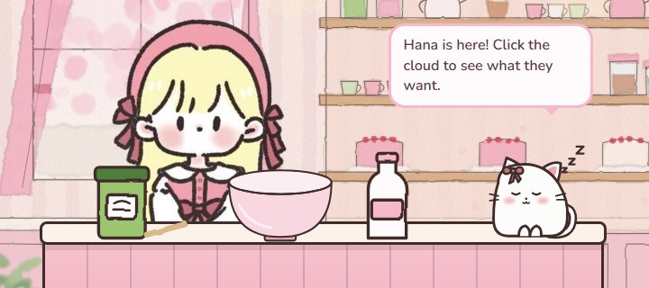
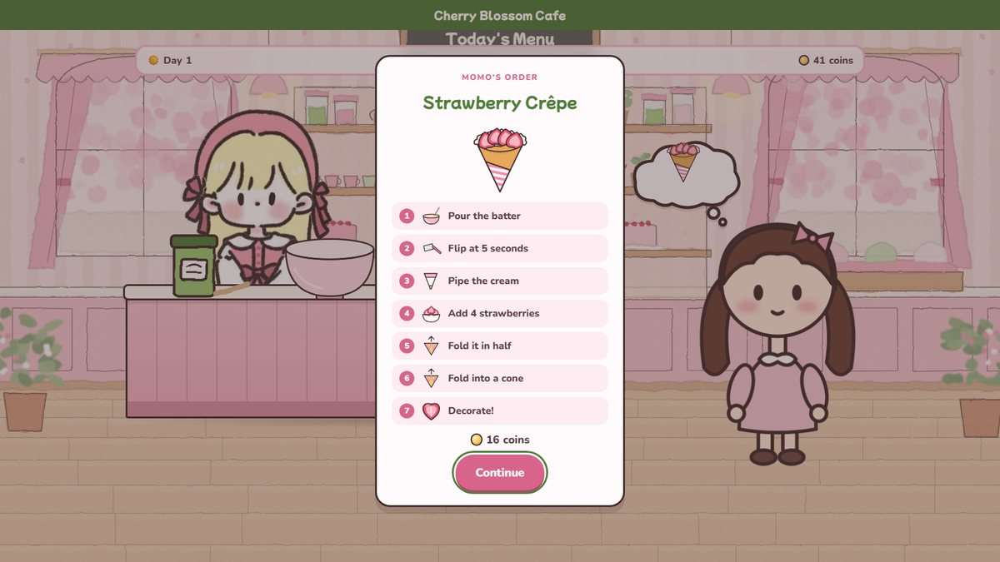
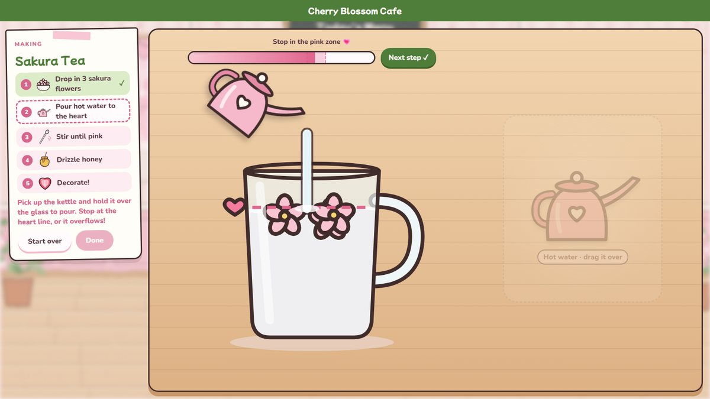
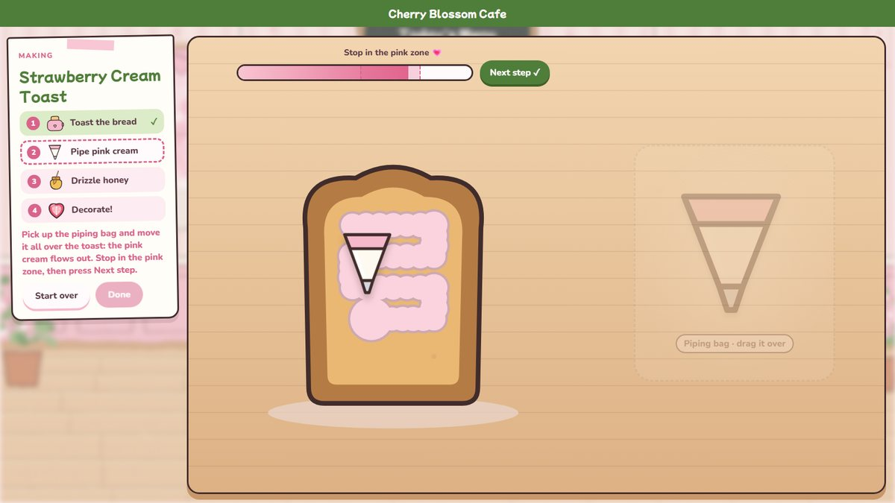
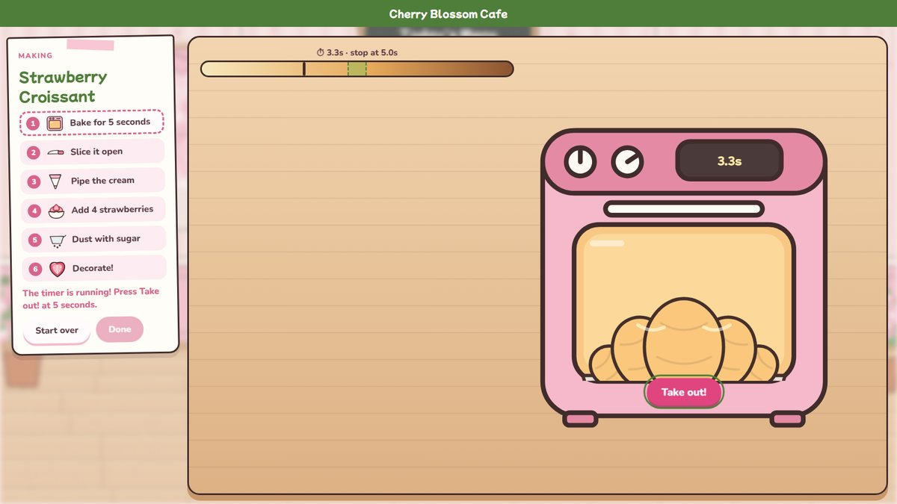
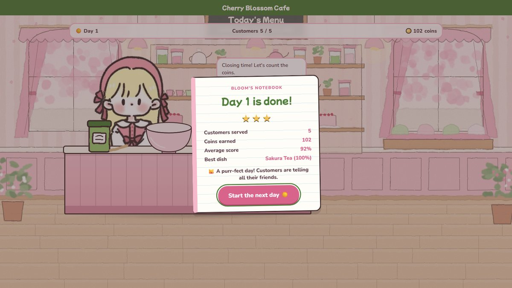

# 🌸 Cherry Blossom Cafe 🍵

**A cosy pink-and-green cafe cooking game, made in the browser.**

Chef Bloom and her sleepy cat Mochi run a little cafe under the cherry trees.
Customers drop by with a treat in mind. You pick up real tools and pour,
pipe, bake, flip, stir and decorate, then send them off happy
(and earn a few coins on the way).

*Built step by step while learning HTML, CSS and JavaScript. No frameworks, no installs.*

---

## 🍓 Meet the crew

**Chef Bloom** stands behind the counter. She sways, blinks, nods when you're doing well, and hops (with a little heart) when a drink is perfect. Click her and Mochi will tell you a secret about her.

**Mochi** naps on the counter with floating *Zzz*s. He wakes up to give you tips, stretches when you nail an order, and grumbles if you poke him awake: *"I'm not sleeping, I'm supervising."*

---

## ☕ How to play

| | |
|---|---|
|  | **1. A customer walks in.** Their thought cloud shows what they're dreaming of. Click the cloud. |
|  | **2. Read the recipe card.** It shows the dish, every step in order, and the price. Click **Continue**. |
|  | **3. Pick up the big tool and use it.** Each step brings ONE big tool to the table: a kettle, a batter bowl, a piping bag, a knife, a spoon… Drag it over and it pours, pipes or slices wherever you hold it. Stop at the line, then press **Next step**. Pour too much and it overflows! |
|  | **4. Cream flows where you move.** Hold the piping bag over the dessert and draw with it. The meter shows the perfect amount (the pink zone). |
|  | **5. Bake it for real.** Drag the tray into the oven, press **Turn on**, and watch it through the window. Press **Take out!** at **5 seconds**. The toaster pops the bread up by itself, and on the pan you click the crêpe to flip it. |
|  | **6. Decorate however you like.** Chop strawberries on the board (3 chops = 4 slices), then drag slices, cream, bunny cookies, pocky, daisies and more *anywhere* on it. |
|  | **7. Serve it!** A receipt shows your score for every step. Mistakes are allowed: too much batter, 6 strawberries instead of 4, or a late flip all cost points. The better the score, the bigger the tip. |
|  | **8. Finish the day.** Each day has a few customers (one more every day). After the last one, Bloom's notebook shows your stars, coins, average score and best dish. Your day and coins are saved. |

---

## 🧁 The menu

Everything is hands-on: one big tool at a time, and **you** decide when each step is done.

| | Dish | How it's made | Price |
|---|---|---|---|
| 🍵 | **Strawberry Matcha Latte** | Drag 2 scoops of matcha into the bowl, pour hot water, whisk it frothy, pour the bowl into the jar, milk to the pink lines, strawberry cream on top | 15 coins |
| 🍓 | **Strawberry Milk** | Mash strawberries in the glass with the masher, drop in 3 ice cubes, pour the milk, stir until it's all pink | 10 coins |
| 🌸 | **Sakura Tea** | Drop in 3 sakura flowers, pour hot water to the heart line (don't overflow!), stir it pink with a spoon, drip honey anywhere | 9 coins |
| ☕ | **Honey Coffee** | Turn the grinder 4 times, brew a 5-second shot, drip honey with the dipper, pour your own latte art | 11 coins |
| 🍦 | **Strawberry Crêpe** | Pour batter in the pan, click the crêpe to flip it at 5 seconds, pipe cream, add 4 strawberries, fold it in half, then into a cone | 16 coins |
| 🍥 | **Strawberry Roll Cake** | Pour batter in the tray, bake it in the oven for 5 seconds, pipe pink cream, roll it up, slice through with the knife | 18 coins |
| 🍞 | **Strawberry Cream Toast** | Put the bread in the toaster, lift it out when it pops, pipe pink cream, drip honey anywhere | 12 coins |
| 🥐 | **Strawberry Croissant** | Bake it in the oven for 5 seconds, slice it open, pipe cream inside, add 4 strawberries, dust with the sugar sifter | 14 coins |

Everything ends with decorating. Customers love toppings! 💕

---

## 🎀 Play it

1. Download or clone this repo.
2. Open **`index.html`** in your browser.
3. Click the pink **Open the cafe** sign hanging from the wooden board, and walk inside.

### 📱 On your iPhone (works offline!)

1. Open **https://surbhirikhari.github.io/CherryBloomCafe/** in **Safari**.
2. Tap **Share** → **Add to Home Screen**.
3. Open it from the jam-jar icon: it plays full screen, like a real app, and **works with no internet** after the first visit.

Hold your phone sideways, the cafe is wide! 🌸

That's it: no installs, no build step. Works with a mouse, a touchscreen, or a keyboard (Space to pour, arrow keys to stir, Enter to flip).

---

## 🗂️ What's inside

| File | What it does |
|---|---|
| `index.html` | The structure: every screen, button and character |
| `style.css` | The look: colours, layout, and all the little animations |
| `game.js` | The customer loop: arrive → recipe → make → serve → pay → leave |
| `menu.js` | Everything on the menu, and the prices |
| `customers.js` | Draws random customers in Bloom's style, with 3 moods |
| `matcha.js` | The matcha latte drawings: tin, kettle, whisk, bowl, jar |
| `sparkles.js` | The little sparkle trail behind the flower mouse |
| `sw.js` | The service worker: saves the whole game on your phone so it works offline |
| `manifest.webmanifest` | The app's name, icon and colours, for Add to Home Screen |
| `desserts.js` | The dessert drawings, tools and recipes (each step changes the drawing) |
| `drinks.js` | The drink recipes: strawberry milk, sakura tea, honey coffee |
| `bakery.js` | The kitchen station: runs every recipe. Pick up the big tool, use the oven timer, press Next step |
| `decor.js` | The cutting board and drag-anywhere toppings |
| `paint.js` | Shared watercolour "brushes" for drawing scenes |
| `street.js` | Paints the street outside, with walking people |
| `room.js` | Paints the cafe inside: wallpaper, curtains, shelves, lamps |
| `assets/bloom/` | Chef Bloom's 17 picture layers, so each part can move |
| `assets/icons/` | The jam-jar app icon (`icon.svg`) in every size an iPhone needs |
| `assets/fonts/` | The fonts, saved here so they work offline |

---

## 🌱 What I learned building it

- **HTML, CSS & JS** each have one job: structure, look, behaviour
- **Variables, functions and loops**, like the `for` loop that paints every blossom on the trees
- **CSS animations** with `@keyframes`, triggered by adding a class
- **SVG drawing**, plus filters that make smooth shapes look hand-painted
- **`async` / `await`** to script a scene step by step (react → pay → walk out)
- **Pointer events** for picking tools up, pouring, piping and drag-and-drop
- **Data-driven design**: every recipe is just a list of steps, and one station (`bakery.js`) runs them all
- **Saving** progress in the browser with `localStorage`
- **Making it an app**: a web app manifest, an app icon, and a service worker for offline play
- **Splitting code into files** so each one does one thing
- **Debugging!** Like the time only one customer ever came, because the last one's walk-out animation was never cleared 🙈

---

## 🌷 Coming soon

- [x] Desserts! Crêpe, roll cake, cream toast and croissant
- [ ] More drinks and desserts (strawberry shortcake, anyone?)
- [x] Cafe days with an end-of-day notebook, a % score for every step, and saving
- [x] Real tools, a real oven timer, and room for mistakes
- [ ] Several customers at once, with order tickets
- [ ] Ranks that unlock new recipes, and a shop for decorations
- [x] Play it on an iPhone, offline, with its own app icon
- [ ] Sounds: the whisk, the pour, the coin *ding*

---

## 💐 Credits

- Game by **Surbhi Rikhari**.
- Chef Bloom's artwork is used with the original artist's permission.
- The street, cafe, Mochi, customers, tools and desserts were drawn for this game, inspired by reference art shared with permission.
- Fonts: [Mochiy Pop One](https://fonts.google.com/specimen/Mochiy+Pop+One), [Nunito](https://fonts.google.com/specimen/Nunito) and [Great Vibes](https://fonts.google.com/specimen/Great+Vibes) from Google Fonts (Open Font License), saved in `assets/fonts/`.

*Made with lots of matcha and a little help from Claude.* 🍵🌸

